# 📦 API de Almoxarifado

API REST simples em **PHP** com **PostgreSQL** para gerenciar o estoque de peças de um almoxarifado. Permite listar, cadastrar, atualizar e excluir peças (CRUD completo), com validações básicas nos dados enviados.


---

## 📑 Sumário

- [Visão geral](#-visão-geral)
- [Estrutura do projeto](#-estrutura-do-projeto)
- [Banco de dados](#-banco-de-dados)
- [Configuração](#-configuração)
- [Como funciona](#-como-funciona)
- [Endpoints](#-endpoints)
  - [GET – Listar peças](#get--listar-peças)
  - [POST – Cadastrar peça](#post--cadastrar-peça)
  - [PUT – Atualizar peça](#put--atualizar-peça)
  - [DELETE – Excluir peça](#delete--excluir-peça)
- [Regras de validação](#-regras-de-validação)
- [Testando com o Thunder Client](#-testando-com-o-thunder-client)
---

## 🔎 Visão geral

Todas as requisições são feitas para um único arquivo, `almoxarifado.php`. A API identifica **o método HTTP** usado (`GET`, `POST`, `PUT` ou `DELETE`) e executa a ação correspondente. Os dados são enviados e recebidos em **JSON**.

| Método   | Ação                    | Corpo (body) |
|----------|-------------------------|:------------:|
| `GET`    | Lista todas as peças    | ❌           |
| `POST`   | Cadastra uma nova peça  | ✅           |
| `PUT`    | Atualiza uma peça       | ✅           |
| `DELETE` | Exclui uma peça         | ✅ (só `id`) |

---

## 🗂 Estrutura do projeto

```
📁 projeto/
├── 📄 almoxarifado.php   # Endpoint principal (rotas e regras de negócio)
├── 📄 conexao.php        # Conexão com o PostgreSQL via PDO
└── 📄 README.md
```

| Arquivo            | Responsabilidade |
|--------------------|------------------|
| `conexao.php`      | Define as credenciais e cria o objeto `$pdo` usado para falar com o banco. |
| `almoxarifado.php` | Importa a conexão, lê o método HTTP e executa o CRUD da tabela `pecas`. |

---

## 🗄 Banco de dados

- **SGBD:** PostgreSQL
- **Banco:** `almoxarifado`
- **Tabela:** `pecas`

Estrutura esperada da tabela (baseada nas colunas usadas pelo código):

```sql
CREATE TABLE pecas(
    id SERIAL PRIMARY KEY,
    nome VARCHAR(100) NOT NULL,
    categoria VARCHAR(20) NOT NULL,
    fornecedor VARCHAR(100) NOT NULL,
    quantidade INTEGER NOT NULL,
    preco_unitario DECIMAL(10,2) NOT NULL
);
```

---

## ⚙️ Configuração

### Pré-requisitos

- PHP 8 ou superior com a extensão **`pdo_pgsql`** habilitada
- PostgreSQL com o banco `almoxarifado` e a tabela `pecas` criados
- Um servidor para rodar o PHP (Apache/XAMPP/Laragon ou o servidor embutido)
- [Thunder Client](https://www.thunderclient.com/) (extensão do VS Code) para testar

### Conexão com o banco

As credenciais ficam em `conexao.php`:

```php
$host   = "SEU_HOST";
$usuario = "SEU_USUARIO";
$senha  = "SUA_SENHA";
$banco  = "almoxarifado";
```

### Rodando o projeto

Com o servidor embutido do PHP, dentro da pasta do projeto:

```bash
php -S localhost:8000
```

A URL base da API será:

```
http://localhost:8000/almoxarifado.php
```

---

## 🧠 Como funciona

```
Thunder Client ──► almoxarifado.php ──► conexao.php ──► PostgreSQL
                         │
                         ├─ lê $_SERVER["REQUEST_METHOD"]
                         ├─ lê o corpo da requisição (php://input)
                         ├─ valida os dados
                         └─ responde em JSON
```

1. `almoxarifado.php` define o cabeçalho `Content-Type: application/json`.
2. Importa `conexao.php`, que cria o `$pdo`.
3. Descobre o método HTTP da requisição.
4. Para `POST`, `PUT` e `DELETE`, lê o corpo da requisição com `file_get_contents("php://input")` e converte com `json_decode`.
5. Valida os campos e executa o SQL usando **prepared statements** (protege contra SQL Injection).
6. Devolve uma resposta em JSON.

---

## 🚀 Endpoints

**URL base:** `http://localhost:8000/almoxarifado.php`

---

### GET – Listar peças

Retorna todas as peças cadastradas, ordenadas pelo `id`.

**Requisição**

```http
GET /almoxarifado.php
```

**Resposta**

```json
[
  {
    "id": 1,
    "nome": "Disjuntor 20A",
    "categoria": "eletrica",
    "fornecedor": "Eletro Sul",
    "quantidade": 50,
    "preco_unitario": "12.90"
  },
  {
    "id": 2,
    "nome": "Rolamento 6203",
    "categoria": "mecanica",
    "fornecedor": "Mecânica Brasil",
    "quantidade": 30,
    "preco_unitario": "25.00"
  }
]
```

📸 **Print do teste:**

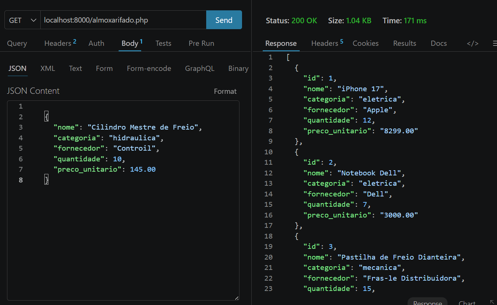

---

### POST – Cadastrar peça

Cadastra uma nova peça. O `id` é gerado automaticamente pelo banco.

**Requisição**

```http
POST /almoxarifado.php
Content-Type: application/json
```

```json
{
  "nome": "Válvula Solenoide",
  "categoria": "hidraulica",
  "fornecedor": "HidroTec",
  "quantidade": 15,
  "preco_unitario": 89.90
}
```

**Resposta (sucesso)**

```json
{
  "Mensagem": "Peça cadastrada com sucesso!"
}
```

**Possíveis erros**

| Situação | Resposta |
|----------|----------|
| Categoria inválida | `"Por favor, insira a categoria da peça como 'eletrica', 'mecanica' ou 'hidraulica', sem acentos ou letras maiúsculas."` |
| Quantidade negativa | `"A quantidade de uma peça não deve ser negativa."` |
| Preço zero ou negativo | `"O preço unitário da peça deve ser maior que zero."` |

📸 **Print do teste:**

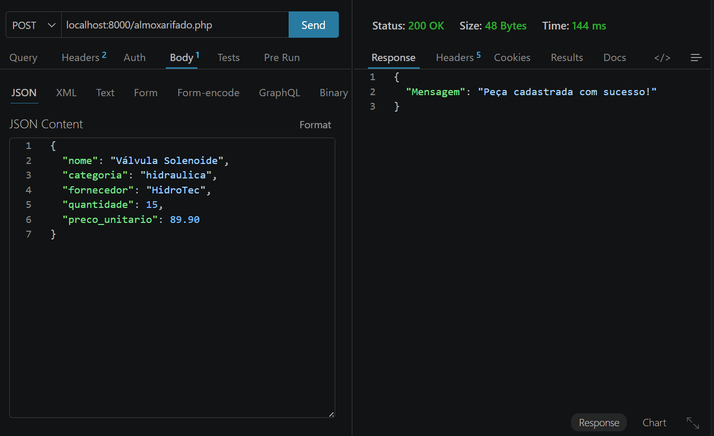

---

### PUT – Atualizar peça

Atualiza **todos os campos** de uma peça existente, identificada pelo `id`.

**Requisição**

```http
PUT /almoxarifado.php
Content-Type: application/json
```

```json
{
  "id": 1,
  "nome": "Disjuntor 25A",
  "categoria": "eletrica",
  "fornecedor": "Eletro Sul",
  "quantidade": 40,
  "preco_unitario": 15.50
}
```

**Resposta (sucesso)**

```json
{
  "Mensagem": "Peça atualizada com sucesso!"
}
```


📸 **Print do teste:**

<!-- Substitua o caminho abaixo pelo print do seu PUT -->
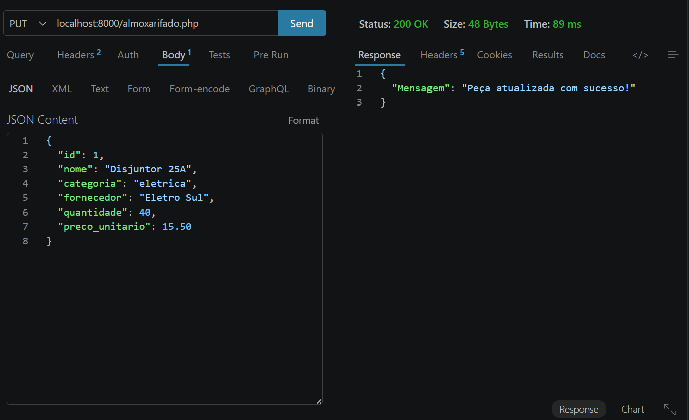

---

### DELETE – Excluir peça

Remove uma peça pelo `id`.

**Requisição**

```http
DELETE /almoxarifado.php
Content-Type: application/json
```

```json
{
  "id": 1
}
```

**Resposta (sucesso)**

```json
{
  "Mensagem": "Peça excluída com sucesso!"
}
```

📸 **Print do teste:**

<!-- Substitua o caminho abaixo pelo print do seu DELETE -->
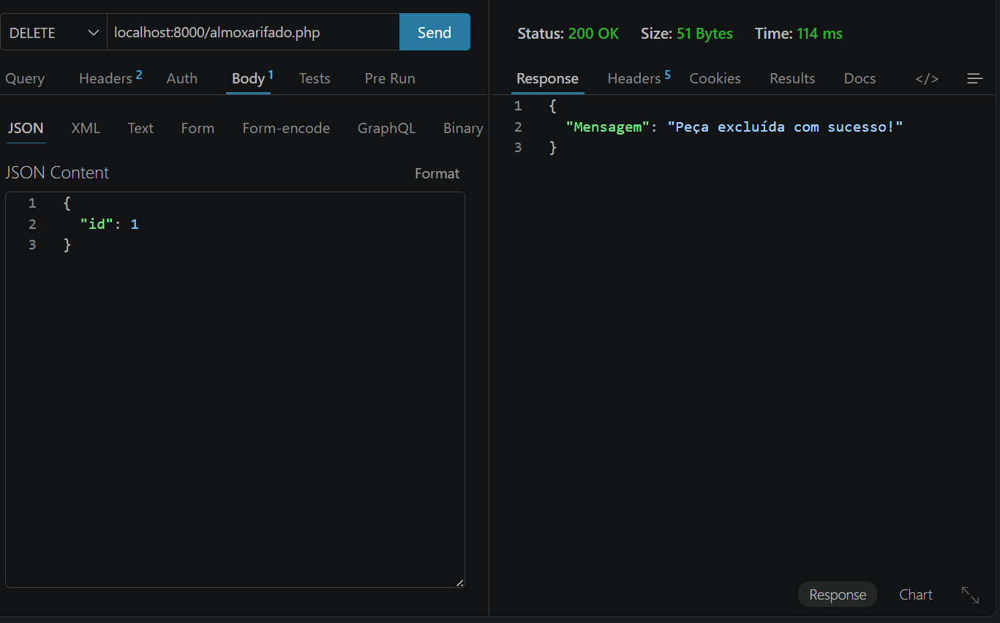

---

## ✅ Regras de validação

Aplicadas no `POST` e no `PUT`:

| Campo            | Regra |
|------------------|-------|
| `categoria`      | Deve ser exatamente `eletrica`, `mecanica` ou `hidraulica` (minúsculas, sem acento). |
| `quantidade`     | Deve ser **maior ou igual a 0**. |
| `preco_unitario` | Deve ser **maior que 0**. |

As validações são feitas nessa ordem: categoria → quantidade → preço. A API retorna apenas a **primeira** mensagem de erro encontrada.

---

## ⚡ Testando com o Thunder Client

1. Abra o **VS Code** e instale a extensão **Thunder Client**.
2. Clique no ícone do Thunder Client na barra lateral e em **New Request**.
3. Escolha o **método** (GET, POST, PUT ou DELETE) e informe a URL:
   ```
   http://localhost:8000/almoxarifado.php
   ```
4. Para `POST`, `PUT` e `DELETE`: vá na aba **Body → JSON** e cole o JSON do exemplo.
5. Clique em **Send** e confira a resposta no painel à direita.

📸 **Print da configuração do Thunder Client:**

<!-- Substitua o caminho abaixo por um print da tela do Thunder Client -->
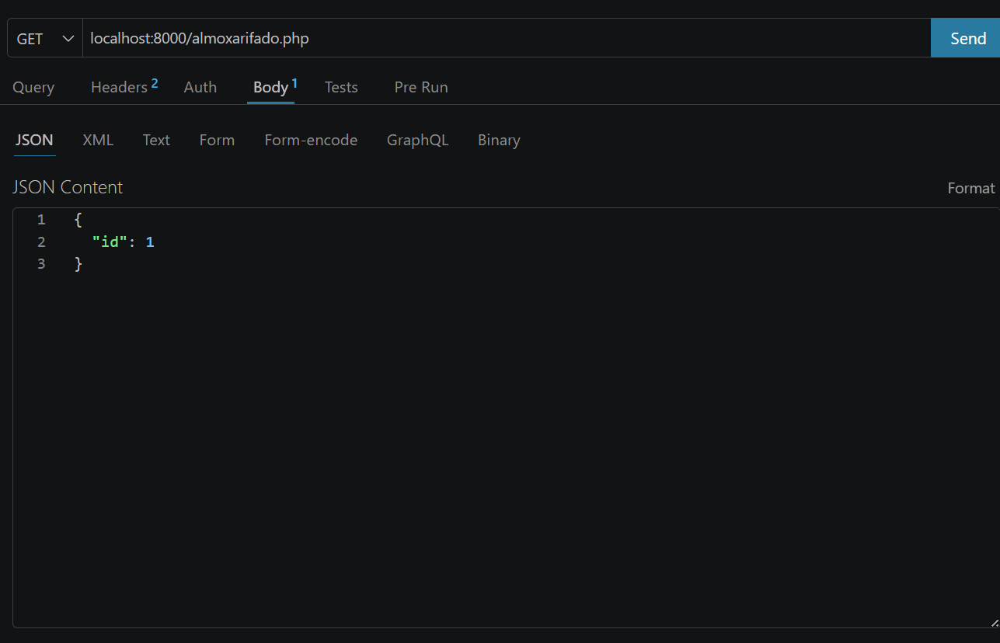

---

## 📊 Atividade: Consultas para a gerência

Por fim, a gerência quer usar esses dados para tomar decisões. Com as funções `SUM`, `MAX`, `MIN` e `AVG`, apelidos com `AS` e, quando necessário, a cláusula `WHERE`, abaixo estão as consultas SQL que respondem a cada pergunta.

> 💡 Todas as consultas são executadas na tabela `pecas` do banco `almoxarifado`.

---

### 1️⃣ Quantas unidades de peças existem no almoxarifado, somando todas?

```sql
SELECT SUM(quantidade) AS total_unidades
FROM pecas;
```

📸 **Print do resultado:**

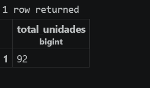

---

### 2️⃣ Qual é o valor total do estoque, em reais?

Como cada peça pode ter várias unidades, multiplicamos `quantidade` por `preco_unitario` em cada linha e depois somamos tudo.

```sql
SELECT SUM(quantidade * preco_unitario) AS valor_total_estoque
FROM pecas;
```

📸 **Print do resultado:**

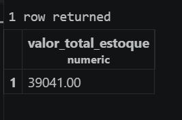

---

### 3️⃣ Qual é o preço unitário da peça mais cara?

```sql
SELECT MAX(preco_unitario) AS preco_mais_caro
FROM pecas;
```

📸 **Print do resultado:**

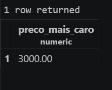

---

### 4️⃣ Qual é o preço unitário da peça mais barata?

```sql
SELECT MIN(preco_unitario) AS preco_mais_barato
FROM pecas;
```

📸 **Print do resultado:**

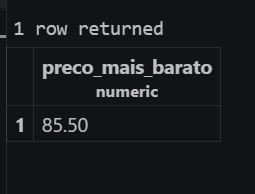

---

### 5️⃣ Qual é o preço médio das peças, com duas casas decimais?

A função `AVG` calcula a média e a função `ROUND(valor, casas)` arredonda o resultado para 2 casas decimais.

```sql
SELECT ROUND(AVG(preco_unitario), 2) AS preco_medio
FROM pecas;
```

📸 **Print do resultado:**

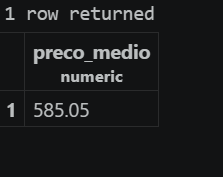

---

### 6️⃣ Qual é o valor total em estoque só das peças da categoria `eletrica`?

O `WHERE` filtra apenas as peças elétricas antes de somar.

```sql
SELECT SUM(quantidade * preco_unitario) AS valor_total_eletrica
FROM pecas
WHERE categoria = 'eletrica';
```

📸 **Print do resultado:**

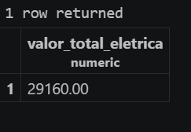

---

### 📋 Resumo

| # | Pergunta | Função usada | Apelido (`AS`) |
|---|----------|--------------|----------------|
| 1 | Total de unidades | `SUM` | `total_unidades` |
| 2 | Valor total do estoque | `SUM` | `valor_total_estoque` |
| 3 | Peça mais cara | `MAX` | `preco_mais_caro` |
| 4 | Peça mais barata | `MIN` | `preco_mais_barato` |
| 5 | Preço médio | `AVG` + `ROUND` | `preco_medio` |
| 6 | Valor total das elétricas | `SUM` + `WHERE` | `valor_total_eletrica` |
